# RetroGBm

A free, open source Game Boy and Game Boy Color emulator for Windows and Android. No ads, link play between a phone and a PC, and live tools for looking inside the game you're playing.

**[Download for Windows](https://github.com/Callum5042/RetroGBm/releases/latest/download/RetroGBm-Win32.zip)** &nbsp;-&nbsp; 
**[Download for Android](https://github.com/Callum5042/RetroGBm/releases/latest/download/RetroGBm-Android.zip)** &nbsp;-&nbsp; 
[Website](https://retrogbm.com) &nbsp;-&nbsp; 
[All releases](https://github.com/Callum5042/RetroGBm/releases)

| 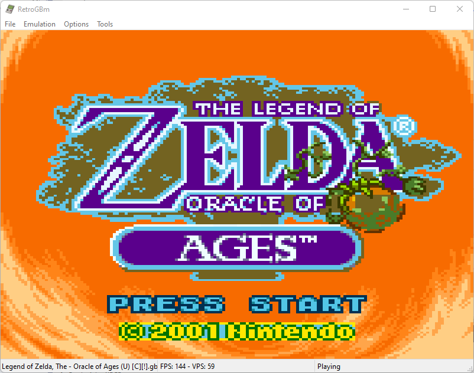 | 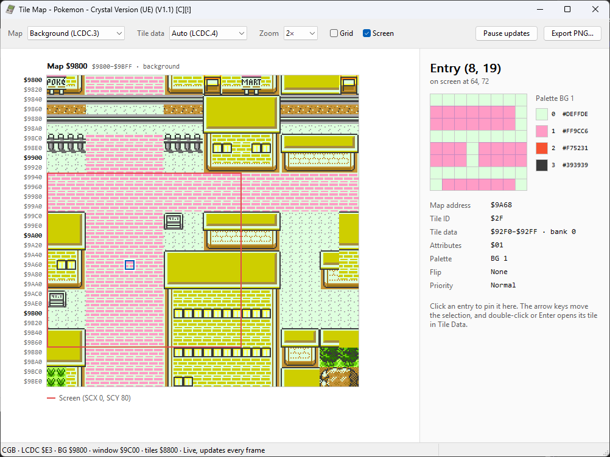 |
|----------|----------|

## Why RetroGBm

- **Free, with no ads**: on both Windows and Android, and open source under GPLv3.
- **Link play between devices**: trade and battle between a Windows PC and an Android phone, or between two PCs.
- **Live inspection tools**: tile data, tile map and object viewers that update as the game runs, plus assembly export, for romhackers and homebrew developers.
- **Fast and lightweight**: a small native app on each platform, written in C++.

## Install

**Windows**: download [RetroGBm-Win32.zip](https://github.com/Callum5042/RetroGBm/releases/latest/download/RetroGBm-Win32.zip), unzip it and run `RetroGBm.exe`. Requires Windows 10 or later.

**Android**: download [RetroGBm-Android.zip](https://github.com/Callum5042/RetroGBm/releases/latest/download/RetroGBm-Android.zip), unzip it and install the APK. Requires Android 10 or later. Android will ask you to allow installing apps from your browser or file manager.

RetroGBm does not come with any games. Use ROM files dumped from cartridges you own.

## Features

- Plays Game Boy and Game Boy Color games, with sound
- Multiple save states with rotating quick saves, plus battery-backed in-game saves
- Link cable support over the network
- GameShark cheat codes, saved per game
- Controller support on Windows and Android, and keyboard remapping on Windows
- Adjustable emulation speed
- Play time tracking
- CGB colours for DMG games, enabled by default, with a grayscale option
- Real-Time Clock (RTC) emulation
- Support for MBC1, MBC2, MBC3, and MBC5 mappers
- Dot-based PPU timing with variable pixel transfer and STAT interrupts
- SM83 assembly export

See the [compatibility list](/Compatibility.md) for the games tested so far.

### Link play

One Windows PC hosts and the other device connects to it using the host's IP address.

- **Host**: on Windows, choose **Options > Network Host**.
- **Connect**: on Windows, choose **Options > Network Connect**. On Android, open the options and choose **Connect**.

Hosting from Android is not available yet.

## Tools

The Windows app has tools for looking inside the game you're playing, opened from the **Tools** menu. The viewers update live as the game runs.

- **Tile Data**: every tile in VRAM across both banks, with the address, palette and bytes of the selected tile, and PNG export
- **Tile Map**: the background and window maps with the visible screen outlined, and the tile, palette and attributes of the selected entry
- **Objects (OAM)**: all 40 sprites, including hidden ones, with the position, tile and palette of the selected object
- **Cheats**: add GameShark codes per game and switch them on and off while playing
- **Properties**: cartridge details from the ROM header, checksums and play time
- **CPU Registers**: live values of PC, SP and the 8-bit registers
- **Export Assembly**: saves the game's code as an `.asm` file

| 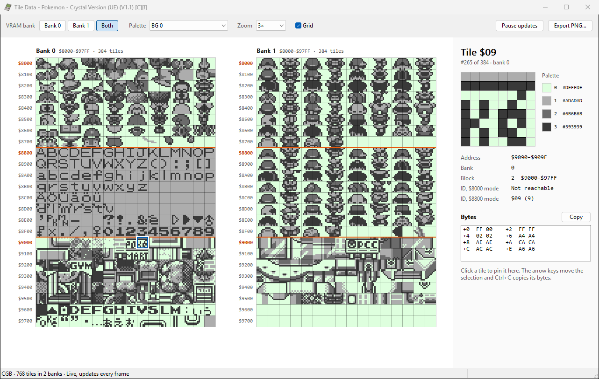 |  | 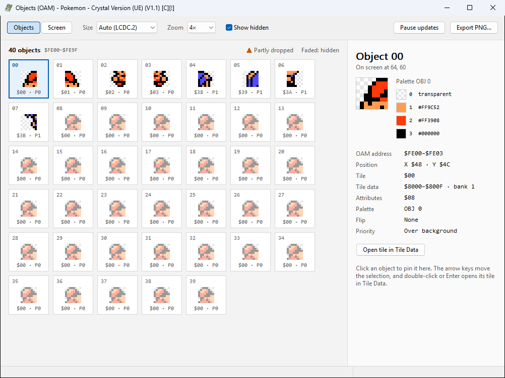 |
|----------|----------|----------|
| 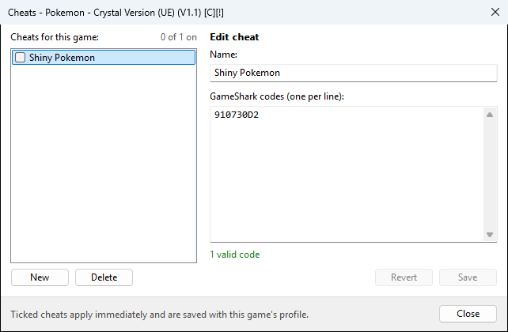 | 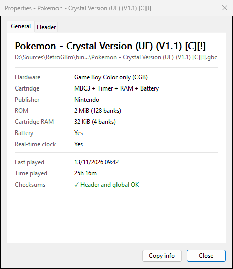 | |

## Screenshots

| 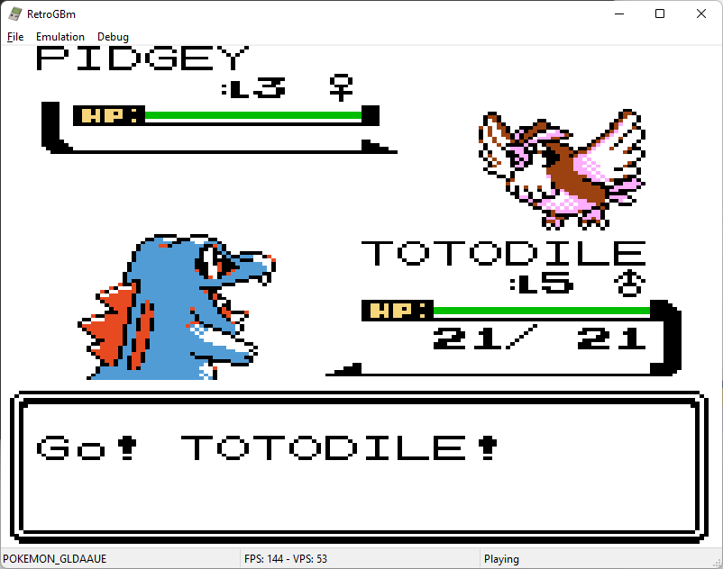 | 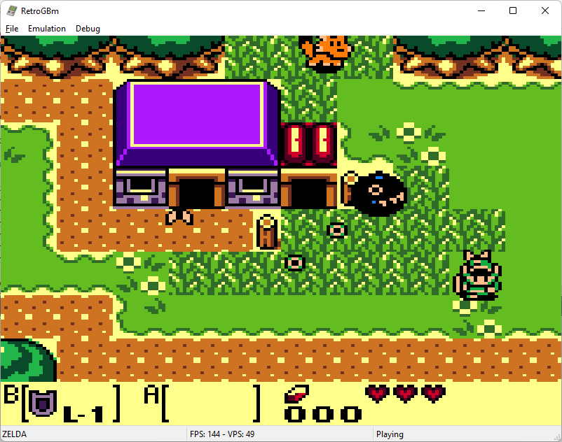 | 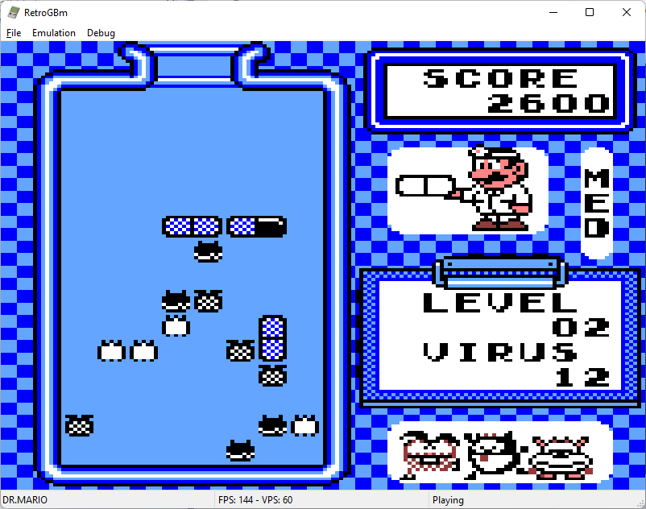 |
|----------|----------|----------|
| 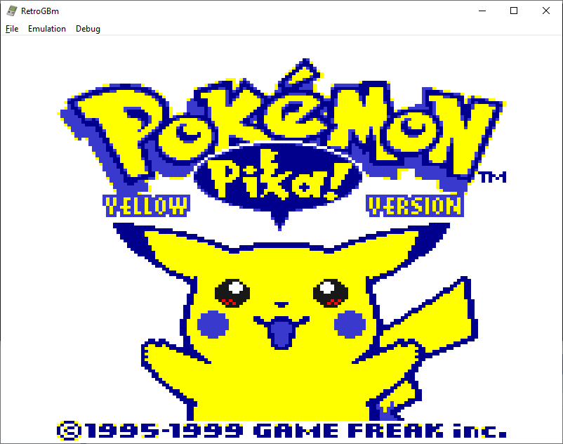 | 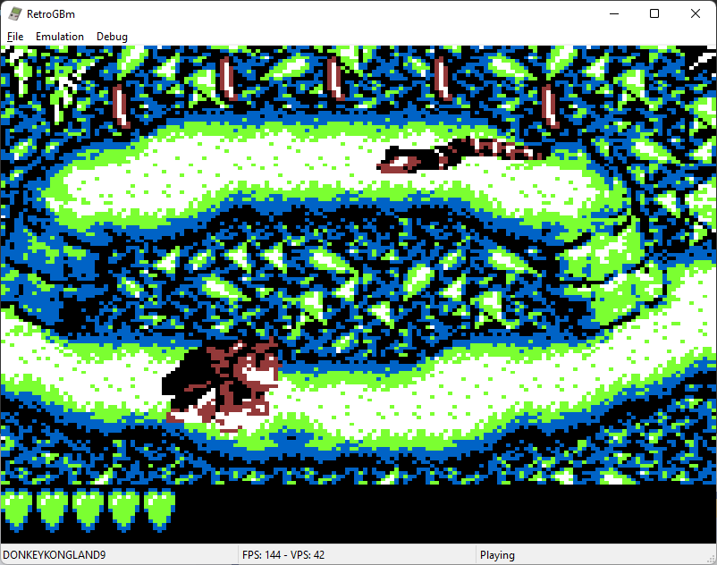  | 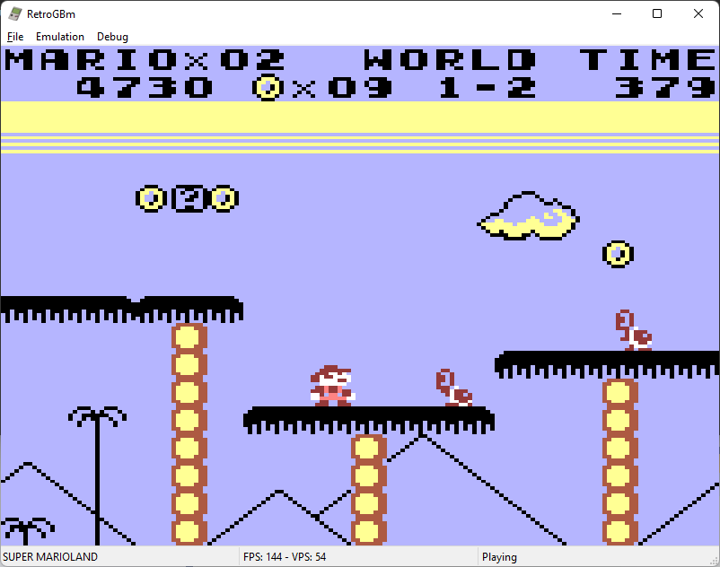  |
| 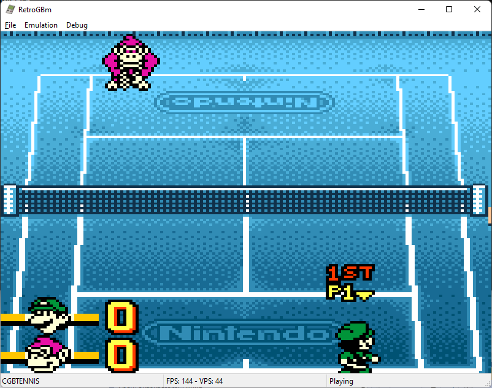 | 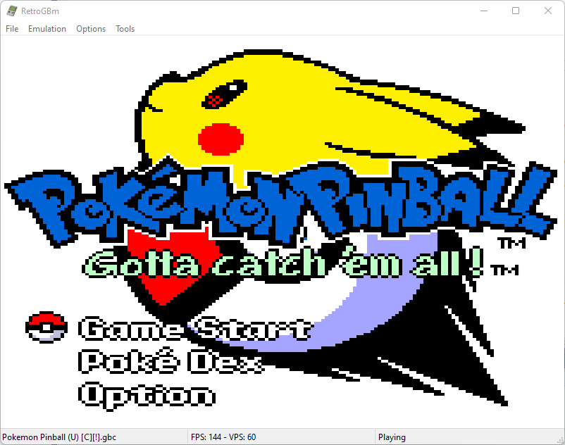  |   |

| 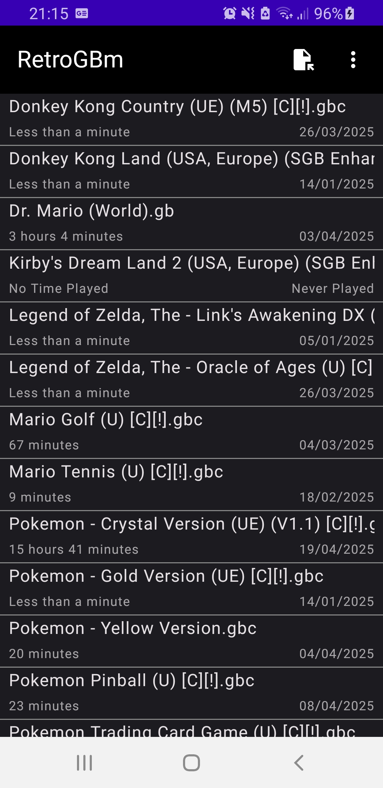 | 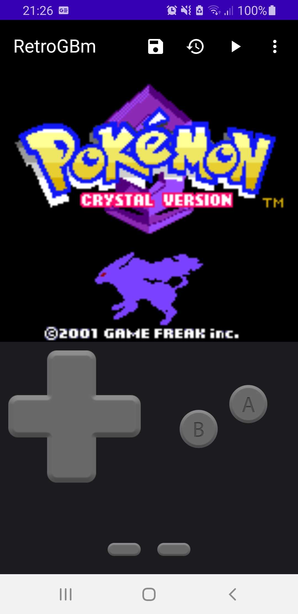 | 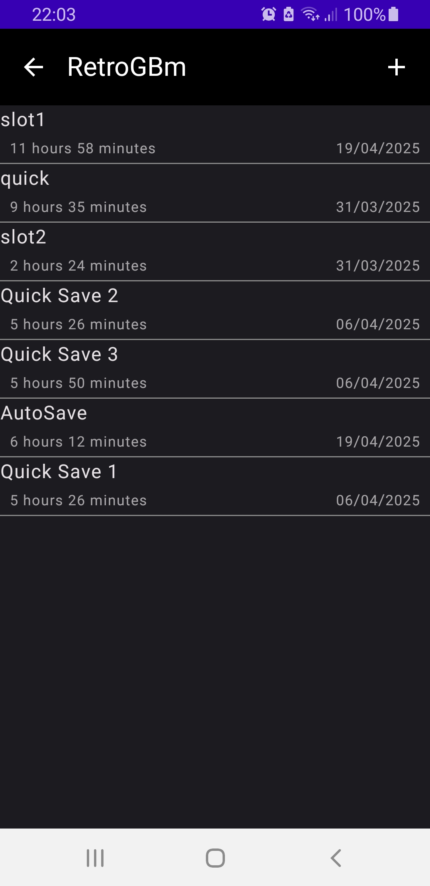 |
|----------|----------|----------|

## Build

**Windows**: Install Visual Studio 2026 and build from the solution file `RetroGBm.sln`.

**Android**: Install Android Studio and open the `android` folder, then build with Android Studio.

## Compatibility

[Compatibility](/Compatibility.md)

## Test roms

[Testing ROMS](/Testing.md)

## License

RetroGBm is released under the [GNU General Public License v3.0](/LICENSE).
