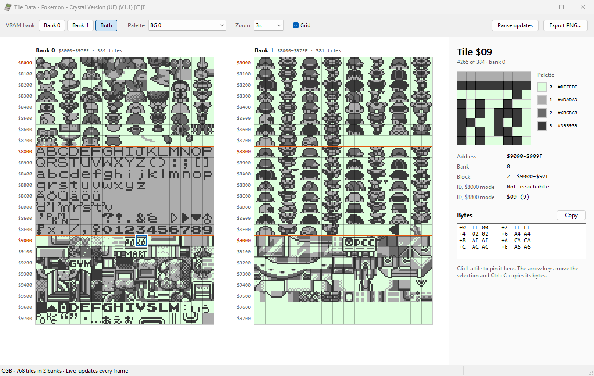
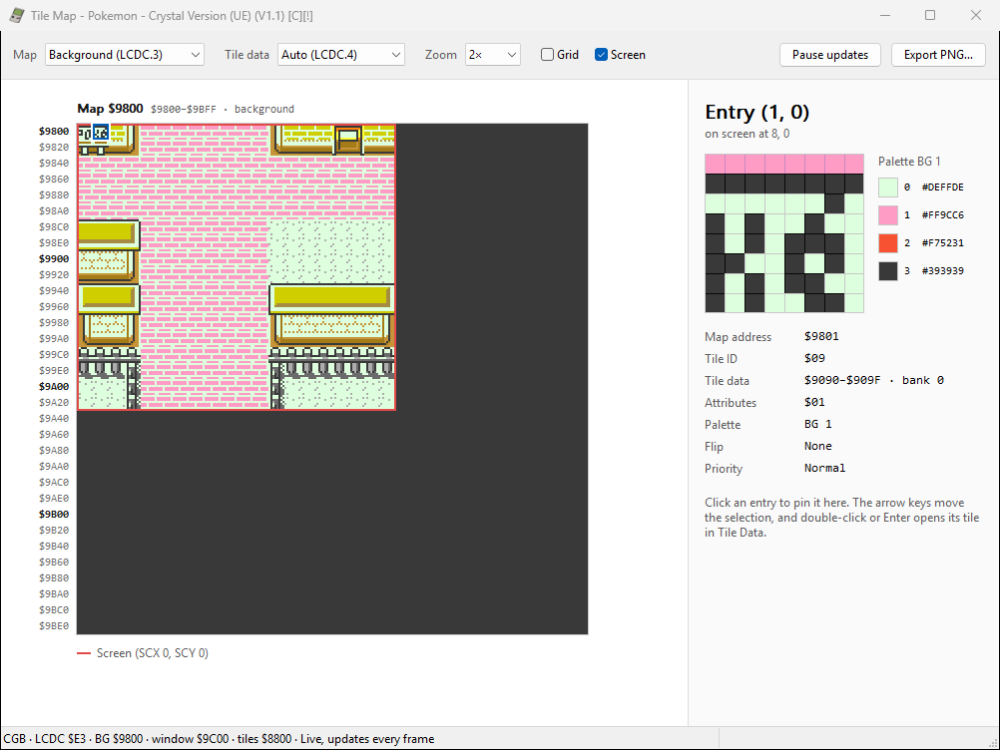
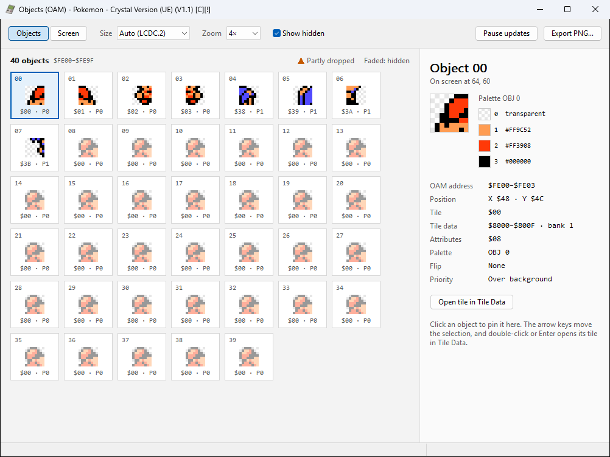
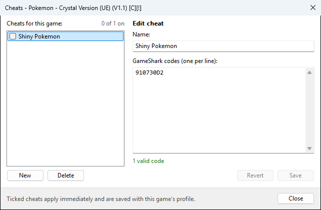
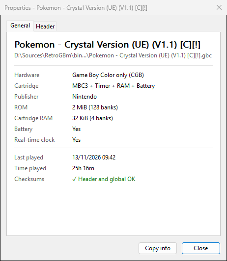

# RetroGBm

A fast and lightweight Game Boy Color emulator written in C++ for Windows and Android.

### Features

- Support for MBC1, MBC2, MBC3, and MBC5 mappers
- Battery-backed save support
- Multiple save states with rotating quick saves
- Adjustable emulation speed
- Real-Time Clock (RTC) emulation
- Dot-based PPU timing with variable pixel transfer and STAT interrupts
- Audio emulation
- CGB colours for DMG games, enabled by default, with a grayscale option on Windows and Android
- Play time tracking
- Link cable support
- Gameshark cheat codes
- SM83 assembly export

### Tools

The Windows app has tools for looking inside the game you're playing, opened from the **Tools** menu. The viewers update live as the game runs.

- **Tile Data**: every tile in VRAM across both banks, with the address, palette and bytes of the selected tile, and PNG export
- **Tile Map**: the background and window maps with the visible screen outlined, and the tile, palette and attributes of the selected entry
- **Objects (OAM)**: all 40 sprites, including hidden ones, with the position, tile and palette of the selected object
- **Cheats**: add GameShark codes per game and switch them on and off while playing
- **Properties**: cartridge details from the ROM header, checksums and play time
- **CPU Registers**: live values of PC, SP and the 8-bit registers
- **Export Assembly**: saves the game's code as an `.asm` file

|  |  |  |
|----------|----------|----------|
|  |  | |

## Screenshots

|  |  |  |
|----------|----------|----------|
|  |   |   |
|  |   |   |

|  |  |  |
|----------|----------|----------|

## Build

**Windows**: Install Visual Studios 2026 and build from the solution file `RetroGBm.sln`.

**Android**: Install Android Studios and open the `android` folder, then build with Android Studios.

## Compatibility

[Compatibility](/Compatibility.md)

## Test roms

[Testing ROMS](/Testing.md)
