# RetroGBm

A fast and lightweight Game Boy Color emulator written in C++ for Windows and Android.


### Features

- Support for MBC1, MBC3, and MBC5 mappers
- Battery-backed save support
- Multiple save states with rotating quick saves
- Adjustable emulation speed
- Real-Time Clock (RTC) emulation
- Dot-based PPU timing with variable pixel transfer and STAT interrupts
- Audio emulation
- CGB colours for DMG games, enabled by default, with a grayscale option on Windows and Android
- Play time tracking
- Link cable support
- Gameshark cheat codes
- SM83 assembly export

## Screenshots

| 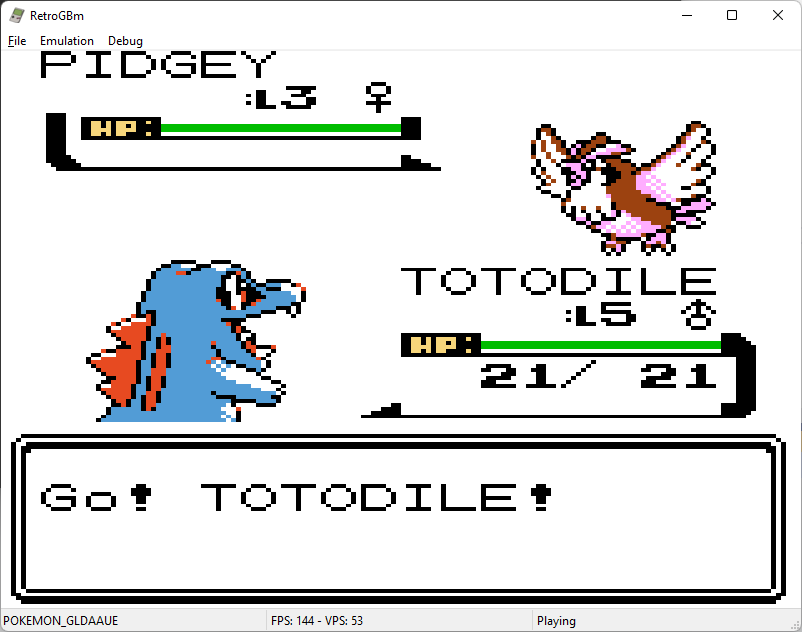 | 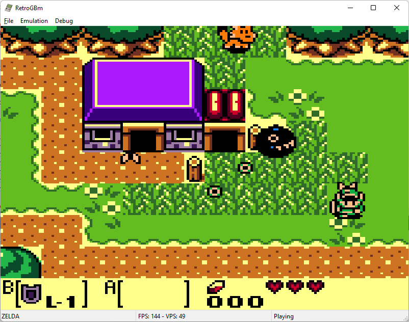 | 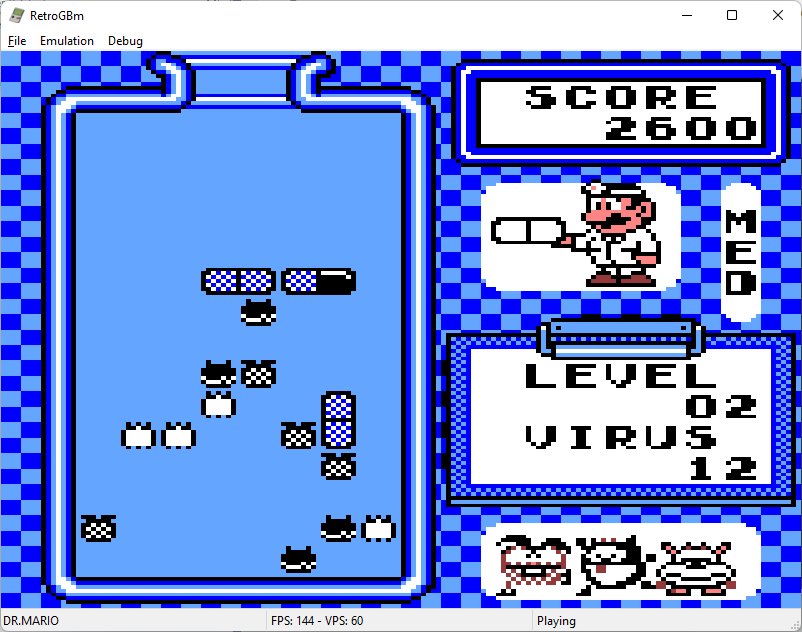 |
|----------|----------|----------|
| 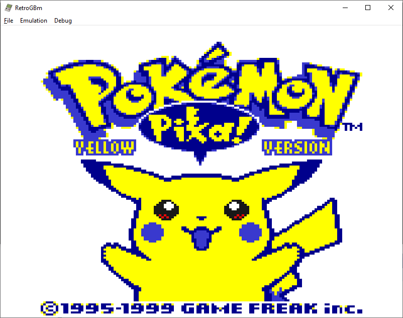 | 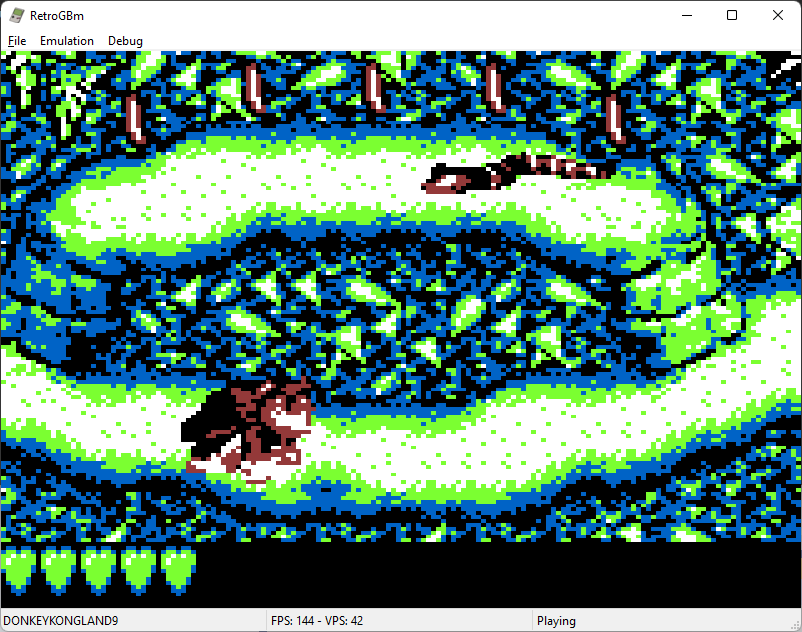  | 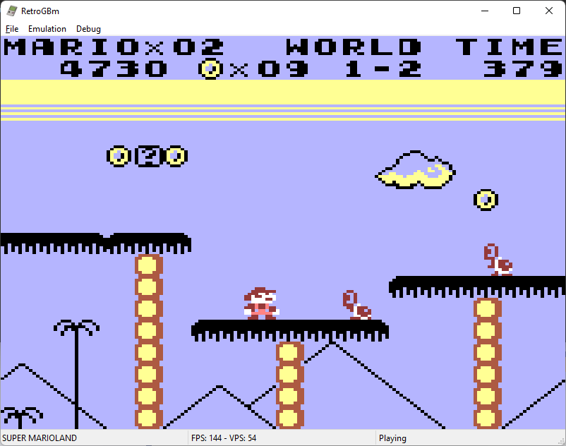  |
| 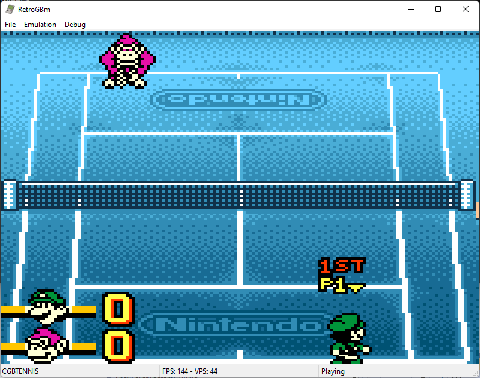 | 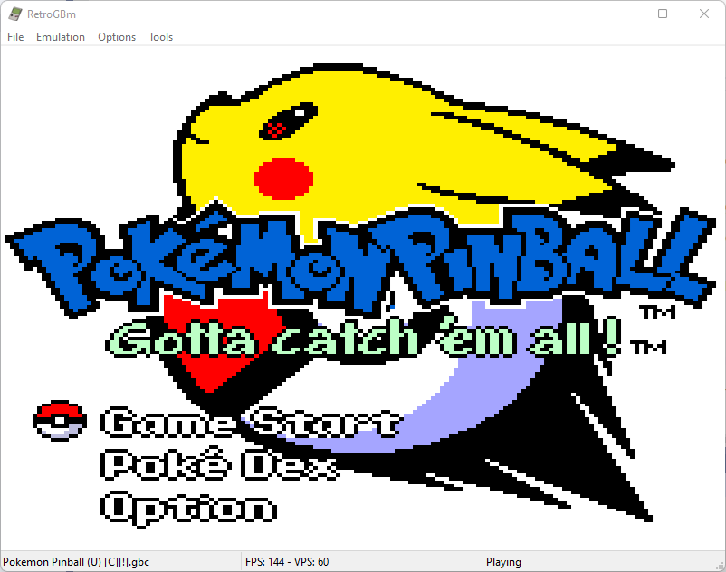  | 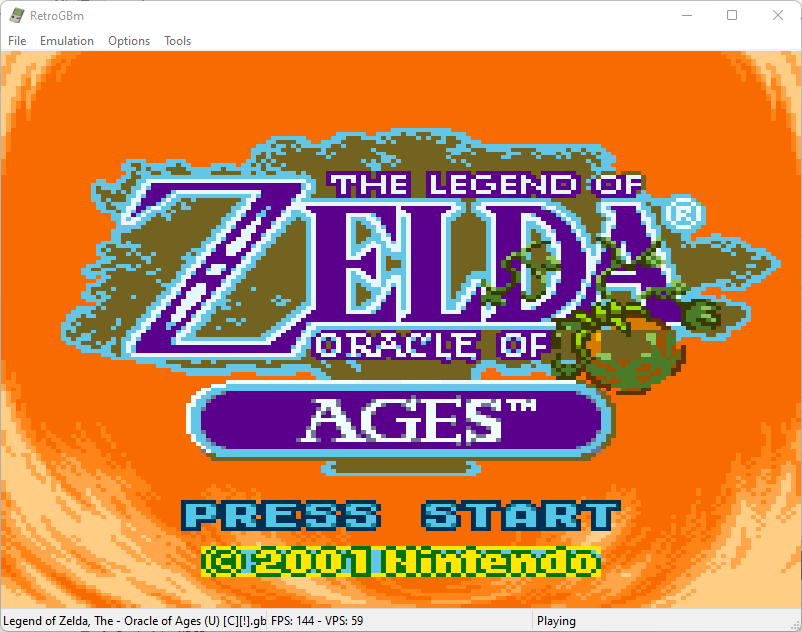  |

| 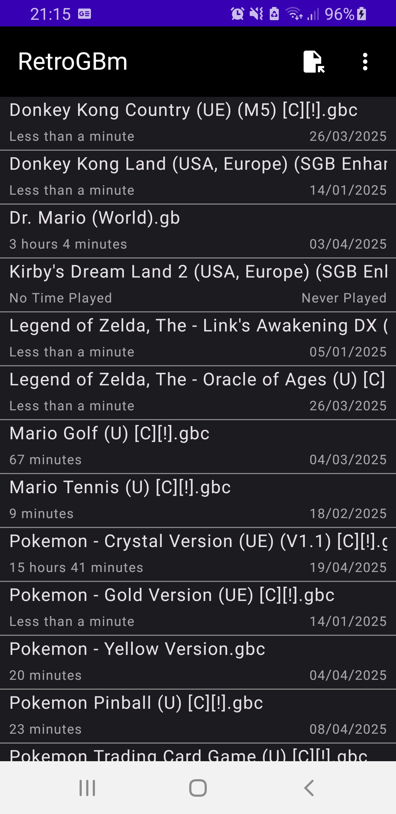 | 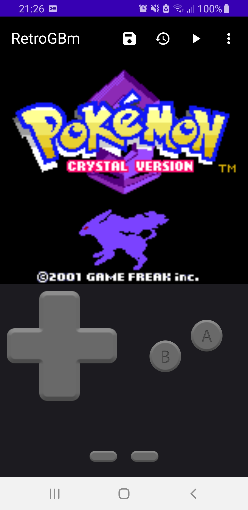 | 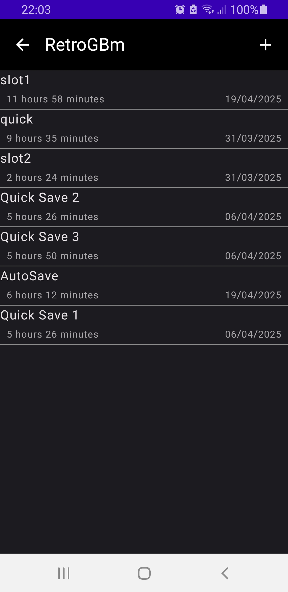 |
|----------|----------|----------|

## Build

**Windows**: Install Visual Studios 2026 and build from the solution file `RetroGBm.sln`.

**Android**: Install Android Studios and open the `android` folder, then build with Android Studios.

## Assembly export

Load a ROM on Windows and choose **Tools > Export Assembly...** to save an `.asm`
listing. It includes all ROM banks, bank-relative addresses, file offsets, and
original instruction bytes. Export reads the cartridge's ROM directly, so the
currently selected bank and emulation progress do not affect the listing.

This is a linear disassembly: the cartridge header is emitted as `db` directives,
but graphics, text, and other data elsewhere are also decoded as instructions.
Illegal opcodes and incomplete instructions at bank or file boundaries are
preserved as `db` directives. Fixed RGBDS sections preserve bank placement. The
listing can be reassembled, but it does not infer names or data sections.

To rebuild an exported assembly file, download the
[RGBDS command-line assembler/linker](https://github.com/gbdev/rgbds/releases)
and run these commands in PowerShell from its directory. Use the path to your
exported `.asm` file; quote filenames containing spaces. This has been verified
with RGBDS 1.0.4 for standard ROMs containing complete 16 KiB banks.

```powershell
.\rgbasm.exe -o output.o 'game.asm'
.\rgblink.exe -o rebuilt.gb output.o
Get-FileHash 'original.gb', 'rebuilt.gb' -Algorithm SHA256
```

Matching SHA-256 hashes confirm that the rebuilt ROM is identical to the
original, including its header and checksums. For a `True` or `False` result:

```powershell
(Get-FileHash 'original.gb' -Algorithm SHA256).Hash -eq (Get-FileHash 'rebuilt.gb' -Algorithm SHA256).Hash
```

Do not run `rgbfix` for this comparison: header/checksum fixes can change the ROM.
RGBDS may add padding to partial banks in truncated or irregular ROM files;
`rgblink -x` avoids padding for files up to 32 KiB but cannot link larger banked
ROMs. Byte equality proves lossless reconstruction; it does not prove that the
disassembler identified code versus data correctly.

## Compatibility

[Compatibility](/Compatibility.md)

## Test roms

[Testing ROMS](/Testing.md)
